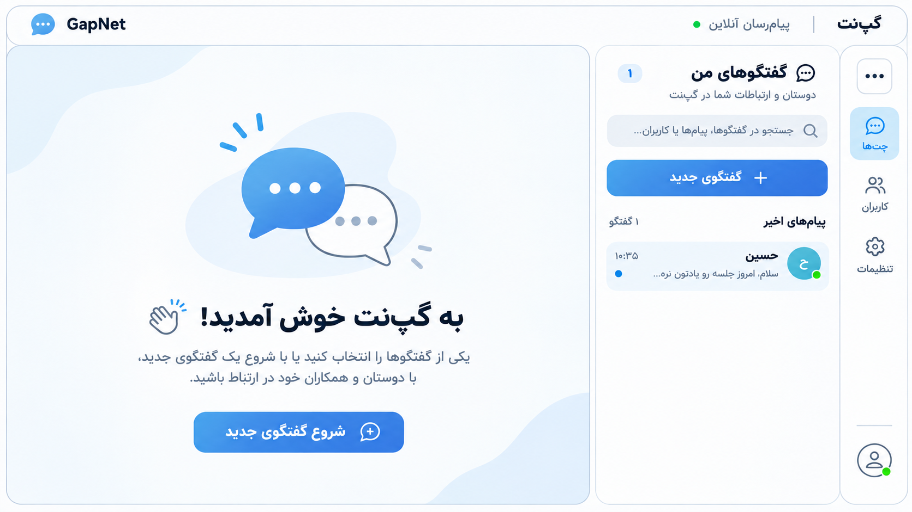
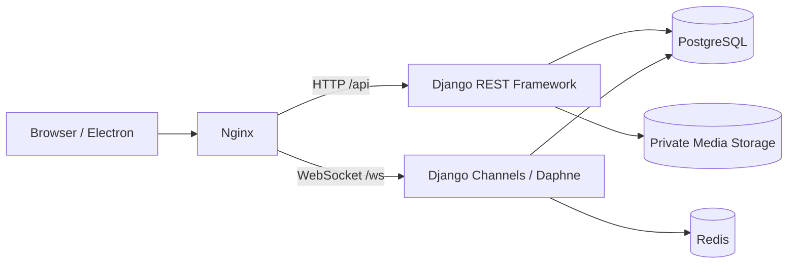

<div align="center">


# 💬 GapNet

### Persian-First, Real-Time Messaging — Clean by Design

**A modern, minimal messaging platform built with React, Django, WebSockets, and Electron.**


[Features](#features) · [Quick Start](#quick-start) · [Desktop App](#desktop-application) · [Architecture](#architecture) · [Documentation](#documentation) · [Security](#security--release-status)

</div>

---

## ✨ Preview



> **Design reference:** This image is the approved visual reference for the GapNet interface. It is not a verified screenshot of the currently running application.

GapNet's interface is designed around simplicity and clarity. It features a **light right-hand navigation rail**, rounded surfaces, subtle hairline borders, pale-blue backgrounds, and soft blue interactive controls. The primary language is Persian, and the interface supports right-to-left (RTL) layouts and responsive chat navigation.

### Design Palette

| Color Role | Hex |
| --- | --- |
| Primary text / ink | `#102235` |
| Sky blue accent | `#53A6E8` |
| Main background | `#F8FAFA` |
| Muted blue-gray | `#7F93A7` |

### Project Artwork

All images shown in this README are **local repository assets**, not externally hosted badges. Keep the `docs/` assets in the same paths when copying this README into your project.

---

## 🚀 Features

| Feature | Source Capability |
| --- | --- |
| **Accounts** | Unique `@username`, registration, sign-in, JWT access and refresh tokens, profile editing |
| **Conversations** | One-to-one and group chats, user search, conversation listing |
| **Messaging** | Stored messages, read status, typing indicators, editing, and deletion |
| **Live Updates** | Django Channels WebSocket events, presence, and reconnect handling |
| **Attachments** | Upload and authenticated conversation-member downloads, with a 10 MB file-type allowlist |
| **Web Interface** | React 19, TypeScript, Vite, responsive light theme, Persian-first RTL support |
| **Desktop Client** | Electron-based Windows client, configurable remote server URL, NSIS installer configuration |
| **Runtime** | Django REST Framework, PostgreSQL, Redis, Nginx, Docker Compose |

**Not included:** end-to-end encryption, voice/video calling, push notifications, published installers, native mobile apps, or independent production security certification.

Features listed here describe what the source code is intended to support; they should not be interpreted as a guarantee of completed end-to-end testing.

---

## 🧰 Tech Stack

| Layer | Technologies |
| --- | --- |
| **Frontend** | React 19 · TypeScript · Vite · Lucide Icons |
| **Backend** | Python 3.12 · Django · Django REST Framework · SimpleJWT · Channels · Daphne |
| **Real-Time Messaging** | WebSockets · Redis channel layer |
| **Storage** | PostgreSQL 16 · Django models · authenticated attachment access |
| **Reverse Proxy** | Nginx |
| **Desktop** | Electron · electron-builder · NSIS (Windows x64) |
| **Automation** | GitHub Actions · PowerShell · Node.js smoke tests |

---

## ⚡ Quick Start

### Windows + Docker Desktop (Recommended)

**Requirements:** Windows 10/11 and Docker Desktop with Docker Compose. Node.js 22+ is additionally required for desktop development and smoke tests.

#### 1. Create your environment file

From the **GapNet project root**:

```powershell
Copy-Item .env.example .env
notepad .env
```

Set `POSTGRES_PASSWORD` and `DJANGO_SECRET_KEY` to **different, strong random values**. For example, if Python is available, generate separate secrets by running:

```powershell
python -c "import secrets; print(secrets.token_urlsafe(48))"
```

Run this command twice. Copy each output into the appropriate variable in `.env`.

> Never commit `.env`, database credentials, private keys, or personal data to GitHub. If a database already exists, keep its existing password unless you are intentionally rotating it.

#### 2. Start the Docker stack

```powershell
powershell -NoProfile -ExecutionPolicy Bypass -File .\scripts\Start-GapNet-Server.ps1
```

| Service | Local URL |
| --- | --- |
| Web application | http://127.0.0.1:8084 |
| Health endpoint | http://127.0.0.1:8084/health/ |
| Django API | http://127.0.0.1:8084/api/ |

These URLs apply after the stack has started successfully. If you change `GAPNET_PORT`, update the URLs accordingly.

#### 3. Inspect running services

```powershell
docker compose ps
docker compose logs --tail 100 backend
docker compose logs --tail 100 web
```

#### 4. Stop the stack

```powershell
docker compose down
```

> **Data safety:** Avoid `docker compose down -v` unless you deliberately intend to delete persistent volumes.

**Existing installation?** Read [Upgrade Notes](docs/UPGRADING.md) before changing Compose names, volumes, or database credentials. The local development stack is **not** a hardened public production deployment.

---

## 🖥️ Desktop Application

GapNet includes an Electron desktop client and scripts for running or packaging it on Windows.

**Launch the desktop development client:**

```powershell
powershell -NoProfile -ExecutionPolicy Bypass -File .\scripts\Start-GapNet-Desktop.ps1
```

**Build a Windows x64 installer (Node.js 22+ required):**

```powershell
powershell -NoProfile -ExecutionPolicy Bypass -File .\scripts\Build-GapNet-Installer.ps1
```

If packaging succeeds, the generated installer is written to `desktop/release/`, which should remain excluded from Git. The installer itself is **not** shipped as part of this source release.

### Local Development Without Docker

Run the backend and frontend in separate terminals:

```powershell
# Terminal A: Django / Daphne
powershell -ExecutionPolicy Bypass -File .\scripts\Run-Local-Backend.ps1

# Terminal B: React / Vite
powershell -ExecutionPolicy Bypass -File .\scripts\Run-Local-Web.ps1
```

The development backend script uses SQLite and an in-memory channel layer. Use Docker for PostgreSQL and Redis integration testing.

---

## 🧪 Testing

**Repository checks (Python 3.11+):**

```powershell
python .\scripts\check_repo.py
```

**Frontend type checking and production build (Node.js 22+):**

```powershell
npm install --prefix frontend
npm run build --prefix frontend
```

**Django backend tests (after installing Python requirements):**

```powershell
python .\backend\manage.py test chat.tests -v 2
```

**Integration smoke test (with the application stack running):**

```powershell
node .\scripts\smoke-test.mjs
```

The repository includes GitHub Actions intended to run source, backend, and frontend checks on pushes and pull requests. **Check the workflow results after your first push.** No claim is made here that the complete Docker build or desktop application passed runtime validation in the packaging environment.

---

## 🏗️ Architecture



### Repository Layout

```text
GapNet/
├── backend/              # Django models, API, WebSocket consumers, tests
├── frontend/             # React, TypeScript, components, UI styles
├── desktop/              # Electron launcher and Windows packaging
├── nginx/                # HTTP / WebSocket reverse proxy
├── scripts/              # Start/build scripts, smoke tests, repo checks
├── docs/                 # Architecture, design, API, deployment and images
│   ├── gapnet-design-reference.png
│   └── assets/
│       ├── badges/       # Local technology/status badges (SVG and PNG)
│       └── icons/        # GapNet icon assets
├── .github/              # CI workflows, issue and PR templates
├── docker-compose.yml
└── .env.example           # Safe environment template
```

### Component Responsibilities

- **React frontend:** Messaging interface, navigation, responsive layouts, and client-side interactions.
- **Django REST API:** Authentication, accounts, conversations, and data operations.
- **Django Channels:** WebSocket connections, messaging events, typing indicators, and presence.
- **PostgreSQL:** Persistent users, conversations, and messages.
- **Redis:** Channel-layer support for real-time communication.
- **Nginx:** Routes incoming HTTP and WebSocket requests.
- **Electron:** Desktop shell and Windows packaging.

---

## 📖 Documentation

| Resource | Description |
| --- | --- |
| [API Documentation](docs/API.md) | API endpoints and integration details |
| [Design System](docs/DESIGN.md) | UI tokens and design guidelines |
| [Deployment Guide](docs/DEPLOYMENT.md) | Deployment setup and security considerations |
| [Upgrade Notes](docs/UPGRADING.md) | Upgrading safely while preserving stored data |
| [Release Checklist](docs/RELEASE_CHECKLIST.md) | Checks to complete before a production release |
| [GitHub Publishing Guide](docs/PUBLISH_GITHUB_FA.md) | GitHub publishing instructions (document currently written in Persian) |
| [Contributing Guide](CONTRIBUTING.md) | Development and contribution conventions |
| [Security Policy](SECURITY.md) | Reporting and handling security issues |

### Getting Started Summary

1. Clone or download the repository.
2. Copy `.env.example` to `.env`.
3. Set secure secrets for `POSTGRES_PASSWORD` and `DJANGO_SECRET_KEY`.
4. Start the stack with `scripts/Start-GapNet-Server.ps1`.
5. Open http://localhost:8084 after the services are healthy.
6. Review container logs and execute the smoke tests.

Keep local databases, installed dependencies, build artifacts, and private configuration outside version control.

---

## 🔐 Security & Release Status

GapNet includes account authentication and conversation access controls, but its source code **has not been independently security-audited**.

### Current Security Considerations

- JWT tokens are used for authentication.
- The browser client currently stores JWTs in `localStorage`.
- File downloads are restricted to authenticated conversation members.
- End-to-end encryption is not implemented.
- Public production security certification has not been completed.

Before hosting GapNet on the public internet, configure HTTPS, rotate and protect credentials, review CORS and origin policies, set up backups and monitoring, and complete security and integration testing.

See [Security Policy](SECURITY.md), [Deployment Guide](docs/DEPLOYMENT.md), and [Release Checklist](docs/RELEASE_CHECKLIST.md).

**Release status:** The repository contains application source and deployment tooling for development and evaluation. Production readiness is not claimed until runtime, integration, and security tests have been completed successfully.

---

## 🤝 Contributing

Bug reports, ideas, and pull requests are welcome. Read [CONTRIBUTING.md](CONTRIBUTING.md) before making changes, and follow the [Security Policy](SECURITY.md) when reporting vulnerabilities.

---

## 📜 License

No open-source license has been selected automatically. The repository owner should choose a license and visibility before describing the code as open source. See the [Licensing Guide](docs/LICENSE_AND_VISIBILITY.md).

---

<div align="center">

### 💬 GapNet

**Modern Messaging. Simple Experience. Real-Time Communication.**

<sub>Built for seamless, Persian-first conversations.</sub>

</div>
